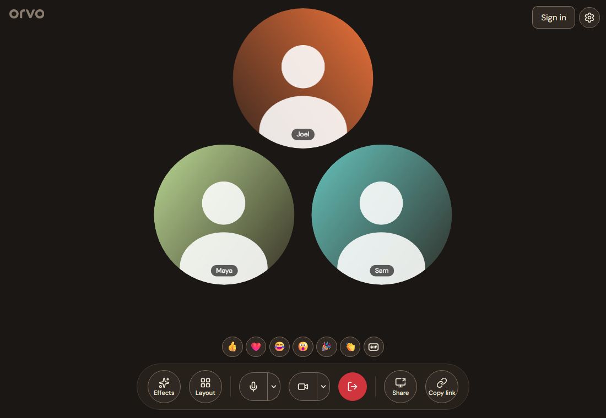
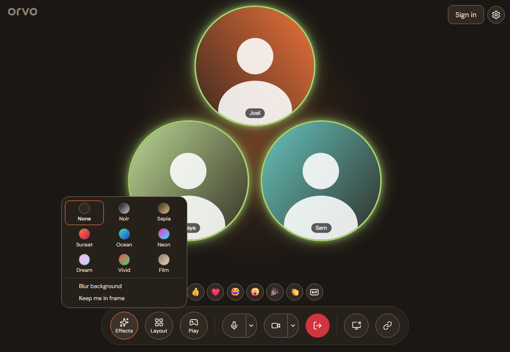
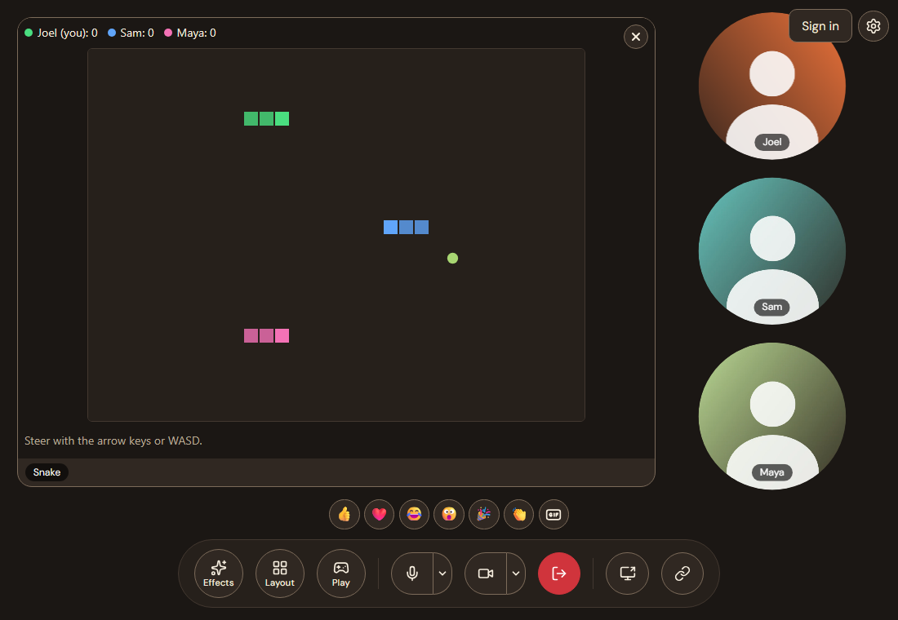
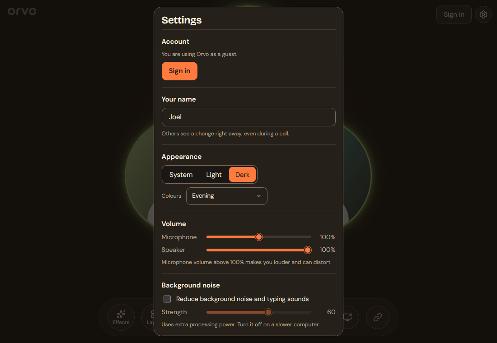

# Orvo

**No agenda. Just company.**

Orvo is a casual video chat app for friends and family. There are no meetings and no schedule: you start a room, share
the link, and the people you like drop in. Everyone appears as a round face bubble, and the app stays out of the way
while you do something else.



## What it does

- **Rooms with a link.** Start a room, copy the link, send it. Guests join from a browser with no account. Rooms hold
  up to 10 people by default.
- **Face bubbles.** People are circles, not a grid of rectangles, and a bubble glows while its person is speaking. Pick a layout from the control bar, or share your
  screen and it appears as a tile beside the bubbles.
- **Reactions.** Send an emoji or a GIF that floats over your video for everyone to see.
- **Mood filters, background blur and framing.** Apply a colour filter, blur your background, or have the camera keep
  you centred. These run on your own computer before the video is sent.
- **Quieter calls.** Optional background noise and typing suppression, with a strength slider.
- **Activities.** Play together without leaving the call. The Play button lists what the server offers, and Snake comes
  with it. Each activity runs in a sandbox that cannot reach your camera, microphone or the network, and the game traffic goes
  directly between players. A server operator can add their own; see [docs/activities.md](docs/activities.md).
- **Your look.** Light and dark modes and three colour palettes.
- **Private by design.** Video and audio go directly between participants (peer-to-peer over WebRTC). A relay is used
  only when two people cannot reach each other directly.
- **Optional accounts.** A server can let people sign in, limit who may start rooms, and mark a room as signed-in only.
- **Desktop app for Windows and macOS.** A small floating window keeps the faces on screen over your other work, with an
  activity in a window of its own, and the app updates itself.





## Get it

**Desktop app.** Download the installer for Windows or macOS from the
[latest release](https://github.com/peaceful-octopus/orvo/releases/latest). The installers are not code-signed yet:
Windows SmartScreen asks you to choose More info, then Run anyway, and on macOS 15 and later you open the app once, then choose Open Anyway in System Settings, Privacy & Security (or run
`xattr -dr com.apple.quarantine /Applications/Orvo.app`).

**In a browser.** Open the address of an Orvo server. On a phone you can install it to the home screen.

**Run your own server.** Orvo is self-hosted. One container serves the web app and everything it needs:

```
cd deploy/personal && docker compose up -d   # http://localhost:8080
```

The image is `ghcr.io/peaceful-octopus/orvo`. Setup for a home server, a small team and a large deployment, including
how to make calls work across different networks, is in [docs/self-hosting.md](docs/self-hosting.md). On a personal
server an admin page at `/admin` changes limits, the announcement banner and relay settings without a restart.

## Settings

Your name, volume, noise suppression, appearance and the server you connect to are in Settings.



## For developers

Code layout, how to run and test it, and the design notes are in [OVERVIEW.md](OVERVIEW.md) and the [docs](docs/) folder.

## License

[AGPL-3.0](LICENSE)
